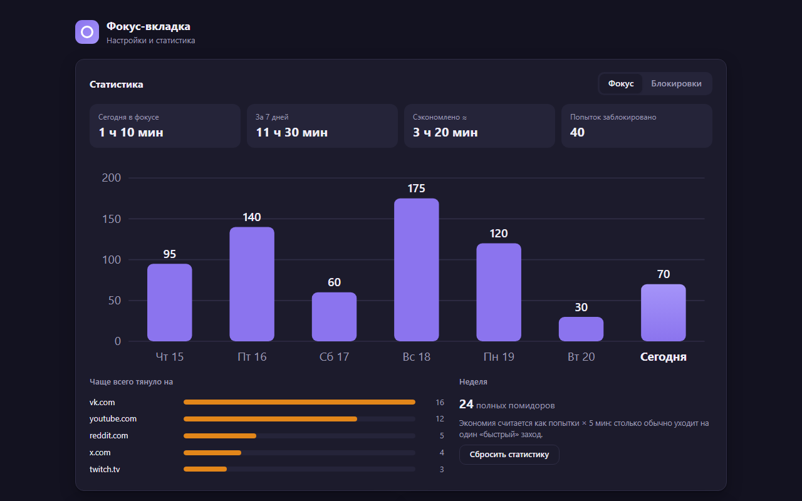
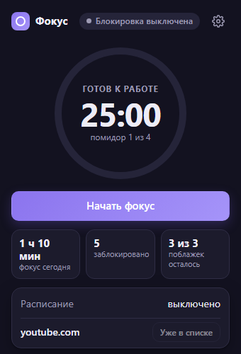
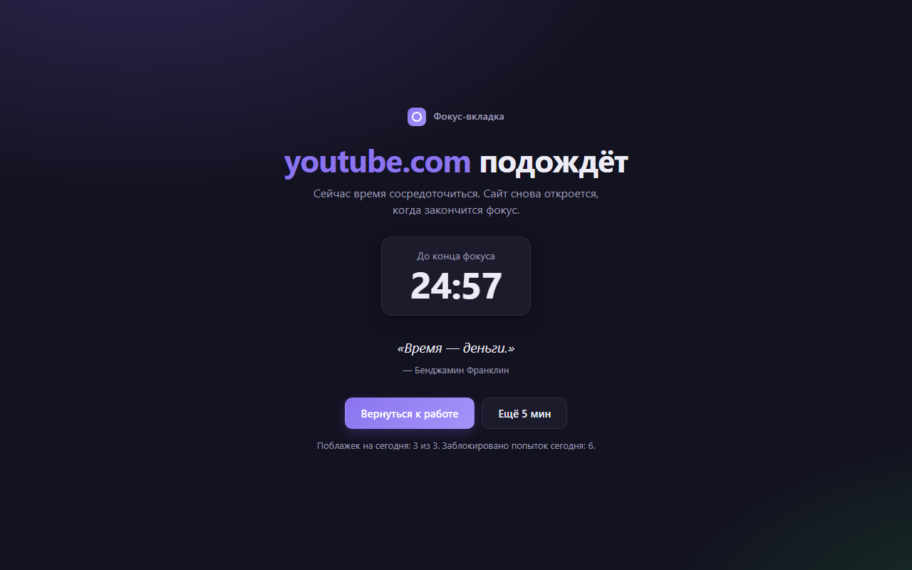

# Фокус-вкладка: помодоро и блокировка отвлекающих сайтов

Расширение для Chrome и Edge. Запускаете помидор, и на 25 минут YouTube, VK и остальные сайты из списка открываются заглушкой с таймером. Можно включить блокировку по расписанию рабочих часов и взять «ещё 5 минут», если очень надо, но не больше трёх раз в день. Статистика показывает, сколько времени в фокусе и куда чаще всего тянуло.


**Демо без установки:** [whysafe.github.io/fokus-tab](https://whysafe.github.io/fokus-tab/). Там открываются настоящие попап, настройки и страница блокировки, а вместо API браузера работает заглушка, так что таймер и статистика живые.



<p>
  
  
</p>

## Возможности

**Таймер**
- Помодоро 25/5 с длинным перерывом каждые 4 помидора, длительности настраиваются.
- Пауза, пропуск фазы, стоп. Незаконченный помидор засчитывается по прошедшим минутам.
- Остаток времени на значке расширения: `25m`, `<1m`, `II` на паузе.
- Уведомление в конце работы и перерыва, перерыв может начинаться сам.

**Блокировка**
- Сайты из списка блокируются во время работы и по расписанию: дни недели и часы, в том числе через полночь (22:00–02:00).
- Поддомены тоже: `m.youtube.com` попадает под `youtube.com`, а `notyoutube.com` нет.
- Уже открытые вкладки с запрещёнными сайтами уходят на заглушку в момент старта.
- На заглушке обратный отсчёт, цитата и две кнопки: вернуться к работе или «ещё 5 минут». После конца фокуса страница сама возвращает на исходный адрес.
- Лимит поблажек в день, повторный клик по уже открытому сайту лимит не тратит.
- Добавить текущий сайт в блок-лист можно из попапа одной кнопкой.

**Статистика**
- Минуты фокуса и попытки зайти на сайты по дням, график за 7 дней, топ сайтов.
- Оценка сэкономленного времени: попытки × минут на один «быстрый» заход.
- Хранится локально, дни старше 90 удаляются. Настройки синхронизируются через аккаунт браузера.

## Запуск

1. Скачайте `fokus-tab.zip` из [Releases](https://github.com/whysafe/fokus-tab/releases) и распакуйте, или клонируйте репозиторий.
2. Откройте `chrome://extensions` (или `edge://extensions`) и включите «Режим разработчика».
3. Нажмите «Загрузить распакованное расширение» и выберите папку `extension`.

Демо локально: любой статический сервер в корне репозитория, например `npx serve .`, затем `/demo/view.html`.

## Как устроено

```
extension/
  background.js     service worker: состояние, правила блокировки, будильники, значок
  popup.*           таймер и сводка за сегодня
  options.*         блок-лист, расписание, настройки, график
  blocked.*         страница-заглушка
  lib/              чистые функции без chrome.*: timer, schedule, domains, allow, stats, settings
demo/               заглушка chrome.* и загрузчик страниц для демо на GitHub Pages
test/               node:test для всего из lib/
```

- Блокировка сделана на `declarativeNetRequest`: на каждый домен одно динамическое правило-редирект для `main_frame`. Исходный адрес передаётся в hash, чтобы вернуть пользователя туда же.
- Service worker в MV3 может быть выгружен в любой момент, поэтому всё состояние лежит в `chrome.storage`, а переходы таймера считаются от временных меток. Если фаза закончилась, пока воркер спал, она завершается при следующем пробуждении.
- Конец фазы, конец поблажки и конец интервала расписания ставятся отдельными `chrome.alarms`, так что правила снимаются вовремя, а не на следующем тике.
- Сообщения и будильники обрабатываются строго по очереди, чтобы параллельные обработчики не затирали состояние.
- Вся логика вынесена в `lib/` как чистые функции, поэтому тестируется в Node без браузера.

## Тесты

```bash
npm test                          # node --test, 26 тестов
node scripts/check-manifest.mjs   # все файлы из manifest.json на месте
```

Покрыты таймер (пауза, длинный перерыв, засчитывание минут), расписание (включая интервалы через полночь), нормализация доменов и регулярки правил, поблажки, статистика и приведение настроек к допустимым значениям. В CI тесты запускаются на каждый push, а на тег собирается zip и публикуется релиз.

## Автор

whysafe · [whysafe.ru](https://whysafe.ru) · Telegram [@yawhysafe](https://t.me/yawhysafe) · канал [@whysafe_official](https://t.me/whysafe_official) · [Kwork](https://kwork.ru/user/whysafe) · hello@whysafe.ru

## Лицензия

MIT
